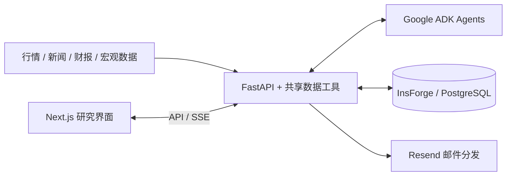

# TheMarketBrew

**面向美股投资者的 AI 研究平台：从市场数据与新闻，到每日简报、个性化摘要和交互式研究。**

[访问网站](https://themarketbrew.com) · [本地开发](#本地开发) · [架构文档](docs/architecture.md) · [贡献指南](docs/contributing.md)

TheMarketBrew 将数据采集、AI 分析、报告存储与邮件分发串成持续运行的研究流程。用户可以通过网页和邮件阅读市场变化，也可以在 Research Desk 中继续提问、筛选股票和查看研究资料。

本仓库包含 Next.js 前端、FastAPI 后端，以及数据处理、Agent 和交付流程的实现。

## 核心能力

| 能力 | 内容 | 页面入口 |
| --- | --- | --- |
| 市场简报 | 市场日报与盘前早报，支持网页阅读和邮件分发 | `/today`、`/morning` |
| 个性化摘要 | 围绕用户自选股组织新闻与研究摘要 | `/for-you` |
| Research Desk | 自然语言选股、连续追问、研究面板与对话历史 | `/research` |
| 个股研究 | 行情、基本面、技术面、财报与 AI 分析 | `/stock` |
| 宏观观察 | 宏观风险、流动性与周度分析 | `/macro` |

研究台支持 `qinbafrank` 与 `aleabitoreddit` 两种博主视角的聊天、技能及历史对话。它们通过独立的 `kol_chat` 开关开放，不代表博主研究室整体恢复。

> **功能范围（2026-10-17）**：Portfolio Health、Research-KB、KOL 独立研究室、Panda、AI Monitor、MCP 和 Onboarding 仍处于停用状态。功能入口以[后端开关](backend/app/core/feature_pause.py)和[前端开关](frontend/src/lib/feature-pause.ts)为准；仓库中保留的模块不等于已开放的产品能力。

## 系统架构



系统主要包含两条工作流：

- **报告生成**：获取数据 → AI 分析 → 结构化输出 → 存储与缓存 → 网页阅读 / 邮件分发。
- **交互研究**：用户提问 → Agent 调用研究工具 → 流式回答与内容面板 → 保存对话与反馈。

| 层级 | 技术 |
| --- | --- |
| 前端 | Next.js 16、React 19、TypeScript、Tailwind CSS 4、shadcn/ui |
| 后端 | Python 3.12、FastAPI、Pydantic |
| AI | Google ADK、Gemini；生成模型统一由 `app.core.ai_models` 管理 |
| 数据来源 | Financial Modeling Prep、yfinance、FRED、TradingView Screener 等 |
| 数据与认证 | InsForge：PostgreSQL、Auth、Edge Functions |
| 支付与邮件 | Stripe、Resend |
| 部署 | Vercel（前端）、Railway（后端） |
| 测试 | Vitest、Playwright、pytest；GitHub Actions CI |

## 本地开发

### 1. 准备环境

使用 **Node.js 22、npm 和 Python 3.12**，与仓库 CI 保持一致。

```bash
git clone https://github.com/nomorekuiqian/stock-agent.git
cd stock-agent
npm ci

cp frontend/.env.example frontend/.env.local
cp backend/.env.example backend/.env
```

根目录的 `npm ci` 会安装 Git hooks。已有环境文件时请保留配置，不要直接覆盖。

### 2. 配置服务

这是依赖外部服务的全栈应用；复制环境模板并不能获得完整功能。

| 配置 | 用途 |
| --- | --- |
| `NEXT_PUBLIC_API_URL` | 前端访问后端，本地设为 `http://localhost:8000/api` |
| 前后端 `INSFORGE_*` / `NEXT_PUBLIC_INSFORGE_*` | 数据库、登录与 Edge Functions；两端需指向同一目标实例 |
| `GOOGLE_API_KEY` | AI 生成与研究对话 |
| `FMP_API_KEY`、`FRED_API_KEY` | 金融与宏观数据 |
| `STRIPE_*`、`RESEND_*` | 按需配置支付测试与邮件功能 |

本地保持 `ENVIRONMENT=development`。**环境模板包含现有 InsForge 实例地址，本地服务不自动隔离云端数据**；涉及数据修改时，应先配置开发实例及所需数据库结构、Edge Functions。支付使用测试密钥，服务端密钥不得放入 `NEXT_PUBLIC_*` 变量。

完整变量见[后端模板](backend/.env.example)、[前端模板](frontend/.env.example)与[后端配置](backend/app/core/config.py)。AI 模型以[共享模型配置](backend/app/core/ai_models.py)为准。

### 3. 启动后端

在仓库根目录打开终端：

```bash
cd backend
python3.12 -m venv venv
source venv/bin/activate
python -m pip install -r requirements.txt
uvicorn app.main:app --reload
```

API 文档：[http://localhost:8000/docs](http://localhost:8000/docs)。

### 4. 启动前端

在仓库根目录另开一个终端：

```bash
cd frontend
npm ci
npm run dev
```

打开 [http://localhost:3000](http://localhost:3000)。

## 验证与测试

前端检查，在 `frontend/` 执行：

```bash
npm run lint
npx tsc --noEmit
npm test
npm run build
```

后端按改动选择测试文件，在已激活虚拟环境的 `backend/` 执行，例如：

```bash
ENVIRONMENT=test pytest tests/test_agent_runtime_feedback_unit.py -v
```

Playwright 使用 `npm run test:e2e`。后端部分 E2E / integration 测试会访问外部服务；运行前检查目标环境与 fixtures。`--run-generate` 会启用真实 AI 生成，`--allow-db-write` 会允许数据库写入，不应作为默认开发检查。

CI 的具体检查与排除项见 [`.github/workflows/ci.yml`](.github/workflows/ci.yml)。

## 仓库结构

```text
backend/
  app/
    core/             # 配置、认证、日志与功能开关
    features/         # 按业务模块组织的 API、Agent 与数据逻辑
    shared/           # 跨模块数据工具与公共能力
    edge_functions/   # InsForge Edge Functions
  migrations/         # 数据库变更
  tests/              # 单元、集成与 E2E 测试
frontend/
  src/
    app/              # Next.js 页面与 Route Handlers
    components/       # 共享界面组件
    contexts/         # 登录与订阅状态
    hooks/            # 数据查询与交互逻辑
    lib/              # API 客户端、认证与工具
  e2e/                # Playwright 测试
docs/                 # 架构、约束、模块索引与工程计划
```

后端活跃实现位于 `app/features/` 与 `app/shared/`；`app/services/` 和 `app/models/` 是重构前的遗留目录，不应新增引用。

## 文档与贡献

| 文档 | 用途 |
| --- | --- |
| [贡献指南](docs/contributing.md) | 协作流程、环境配置与权限边界 |
| [工程规则](AGENTS.md) | 当前项目约束与 AI 编码协作规则 |
| [系统架构](docs/architecture.md) | 系统组件、接口与数据流 |
| [模块索引](docs/agents/module-index.md) | 定位各模块的 `.context.md` |
| [开发参考](docs/agents/development-reference.md) | 开发命令、环境与测试说明 |
| [认证约束](docs/constraints/auth.md) | 用户认证与定时任务认证 |
| [设计系统](docs/constraints/design-system.md) | 界面风格与组件规范 |
| [生产经验](docs/agents/production-gotchas.md) | 数据、邮件、环境等已知注意事项 |

修改前阅读受影响模块的 `.context.md`；提交 PR 时说明问题、改动与验证结果。涉及接口、数据流或认证约束的修改，应同步对应文档。

## 许可证

仓库目前未声明开源许可证；如需复用或分发代码，请先联系维护者确认授权范围。
