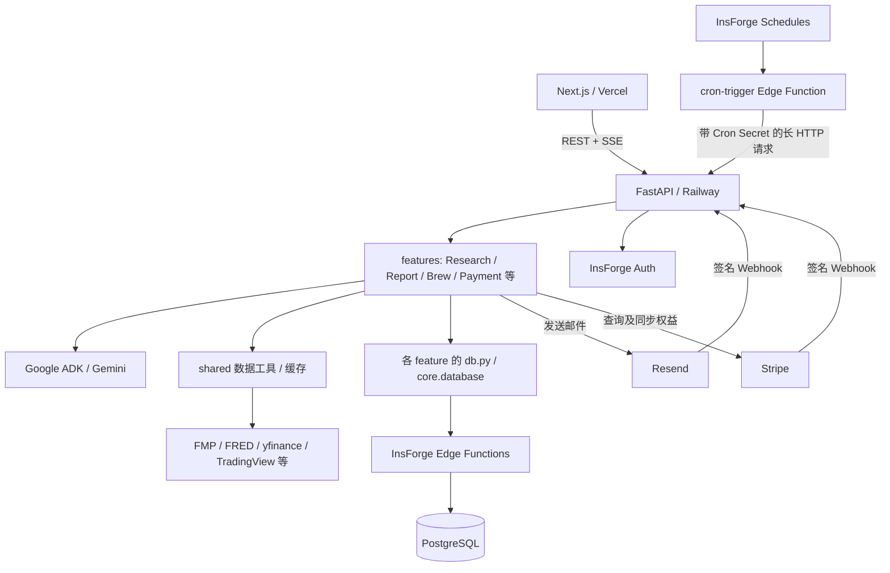
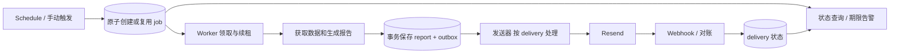

# 后端可靠性审视与 System Design 练习

日期：2026-10-02（Asia/Taipei）。基线：本地工作区，HEAD `67893fb`，包含大量既有未提交修改。本文是代码审视与隔离模拟结果，不代表当前生产部署状态；没有查询生产配置、发送邮件、调用付费模型或写生产数据库。现有暂停产品不纳入恢复计划。

## 判断

保留当前模块化单体。最值得补的是：明确成功条件、持久化执行状态、可安全重试的外部副作用、资源隔离，以及能发现业务失败的监控。新增基础设施应由这些需求推动。

当前已经有 feature 分模块、认证依赖、共享数据工具、连接池、缓存、广播运行记录、会话事件去重、SSE heartbeat、turn 日志、模型计费记录、邮件 webhook 和 CI。可靠性问题主要在这些机制的覆盖范围和故障语义。

## 1. 当前架构

这是一个以 Python 模块化单体为中心、JS Edge Functions 承担数据操作、依赖多个外部提供方的系统。单体内部仍有分布式一致性问题：Python、Edge Function、Postgres、邮件与支付提供方之间没有一个共同事务。

部署文件显示后端用 Uvicorn 启动，没有显式配置多个 worker；线上副本数未核实。`docs/architecture.md` 的 Render、旧模型与产品列表已不能完整描述本地现状。

三条主链路：

| 链路 | 当前处理方式 | 状态在哪里 |
|---|---|---|
| 投研对话 | 验证用户、消费配额、恢复历史、ADK 执行、SSE 返回 | ADK 当前运行在内存；消息和部分事件保存到 `agent_sessions` / `agent_session_events`；picker 保留部分 UI 状态 |
| 日报与邮件 | Schedule 调 Edge dispatcher，后者等待后端生成、保存、发送 | 报告表、`email_broadcast_runs`、Resend 状态和 `email_events` 分开保存 |
| 付费权益 | Stripe webhook 验签，写 subscriptions，并补偿同步权益和邮件 segment | Stripe 与本地 subscriptions 各有状态；有 checkout 回跳与 fresh 查询补偿 |

主要依据：[入口](../../backend/app/main.py)、[Cron dispatcher](../../backend/app/edge_functions/cron-trigger.js)、[runtime 说明](../../backend/app/features/agent_runtime/.context.md)、[支付说明](../../backend/app/features/payment/.context.md)。

## 2. 按收益排序的缺口

### A. 第一优先：广播幂等在故障时失效

**已有**：按 channel/date 获取广播运行记录；完成时校验 `lock_token`。

**代码证据**：

- `features/subscription/broadcast_runs.py:45`：锁服务返回非成功状态时，返回 `acquired=True, lock_unavailable=True`。
- `edge_functions/email-broadcast-runs.js:73-98`：先读到 failed/过期 running，再只按 `run_key` 更新；更新没有检查旧 token、版本或旧状态，两个请求都可能取得执行权。
- `features/subscription/email_service.py:816-852`：free 与 paid 两个广播顺序发送，整体重跑时没有独立恢复已成功 segment 的路径。
- 提供方发送与本地 complete 是两步。发送已成功而响应丢失、或本地完成记录失败时，不能仅根据本地 failed/running 判断邮件未发送。

**影响**：故障时重复发信；部分成功难以定点补发；迟迟无法确认本次到底完成了什么。

**补强**：锁不可用时不发送，返回可重试失败；用事务/条件更新原子领取，加入 `lease_until`、owner token 与续租；记录每个 segment 或 recipient 的独立 delivery 状态。外部结果不确定时进入 `unknown` 并核对提供方记录，再决定是否重试。支持提供方幂等键的具体接口才使用该能力，不能假设所有 Broadcast 接口都支持。

**验收**：并发领取只有一个成功；成功发送但返回超时后不盲目重发；free 成功、paid 失败后只补 paid；失去租约的旧 worker 不能覆盖新状态。数据库 token 本身不能阻止旧 worker 已发出的外部请求，发送侧仍需独立幂等/对账。

### B. 第一优先：业务成功与持久化成功没有统一契约

**代码证据**：

- `features/subscription/router.py:413-441`：保存报告失败时没有阻断，仍进入质量检查和发送。
- `features/daily_report/db.py:164-199`：未找到、非成功 HTTP、异常都可能返回 `None`；调用者无法区分无报告与存储故障。
- `features/agent_runtime/session_store.py:439`：持久化失败后写内存 fallback；`features/screener/router.py:199` 的完成包装器捕获异常，stream 仍可能发 `done`。用户看到答案不等于历史已可靠保存。
- `features/payment/service.py:547-583`：初次 upsert 失败后不检查 fallback 写入返回值，后续仍可能返回 `synced=True`；handler 的异常重试机制因此未必能获知写入失败。

**补强**：repository Interface 明确区分 `Found / NotFound / Unavailable`；关键写入必须返回已持久化结果或抛错。报告与发送意图可在同一数据库事务保存（outbox），让“已保存报告且需要发送”成为可恢复事实。会话输出区分内容生成与保存状态；可以展示暂存内容，但不能悄悄把内存 fallback 当成已保存。

**支付专项**：保留已有验签、失败返回 502 和补偿查询；再加入按 `(account_ref, event_id)` 去重的持久 inbox。按客户/订阅串行重查提供方当前状态，防止旧快照覆盖新状态；不能把 event.created 当成严格版本。处理成功以本地写入确认作为条件，邮件 segment 同步失败另行重试。

**验收**：DB 503 不伪装成 404/空列表/同步成功；保存失败的报告不进入发送；相同 webhook 重放不重复执行副作用，乱序事件不回退当前权益。

### C. 第二优先：持久化历史不等于持久化执行

**已有**：会话消息按 turn/client event 去重、context budget、错误事件和 SSE heartbeat。

**缺口**：Research 在当前 HTTP/进程内运行 ADK（`research_agent.py:1368`）；完成时才写入消息。未在这条链路看到执行前按 turn 领取、持久 run 状态、重启后恢复执行或已完成结果复用。`cron-trigger.js` 对部分报告任务等待 600–900 秒，也没有把长计算交给可恢复 worker。客户端或 dispatcher 超时不能证明后端已停止。

**补强**：先给日报增加 `job_runs` 与步骤 checkpoint；请求在任务持久化后返回 job_id。worker 原子领取并限量执行，记录尝试次数、租约、超时、下一次重试时间和结果。Research 后续复用 run 状态：同一 turn 重试返回已有结果/现有进度，SSE 只负责传输；同一个 session 的并发 turn 要有串行或版本冲突规则。

起步可复用现有 Postgres，通过一个事务性 RPC 完成领取；worker 可以沿用同一仓库、独立进程部署。是否引入独立消息队列取决于吞吐、等待时间和运维成本。引入队列本身不能保证 exactly-once，也不能恢复 LLM 内部状态；恢复应从已持久化业务步骤开始，并明确是否会重新产生模型费用。

**验收**：生成后、发送前杀进程，重启能从保存的报告继续；重试次数有上限；任务不会永远停在 running；客户端刷新可查询明确的 completed/failed/retrying 状态。

### D. 第一优先的小修 + 第二优先的设计：资源隔离与配额覆盖不完整

**代码证据**：

- `features/quota/service.py:129-149`：Research 配额先读后增，数据库失败时 fail open；聊天入口复用该函数。
- 原子扣减 RPC 已存在于 `migrations/research_quota_atomic_consume.sql`，但目前是 holdings_sync 的 `consume_if_under_limit` 路径使用；不代表 Research 已得到同样保护。
- `features/subscription/email_service.py:760,816,1408`：async 路径直接调用同步 Resend SDK；`time.sleep` 也在同一链路运行，可能阻塞处理聊天、认证及健康请求的事件循环。
- `core/rate_limit.py` 使用进程内 limiter；Research streaming 入口没有对应 limiter decorator。每日配额、单位时间速率和同时在途数量是三种不同控制。

**补强**：Research 复用原子 consume，按 turn 关联消费防止网络重试重复扣次；昂贵调用在配额存储失败时返回可重试故障。先把同步 IO 放入受限线程池，批任务随后移入 worker。分别限制交互请求、后台任务和各提供方的并发/预算；给请求总 deadline，重试共享该预算。已有局部控制如 FMP semaphore、digest 并发上限应保留复用。

**验收**：剩余 1 次时 4 个并发请求最多放行 1 个；广播压力下普通只读请求与 SSE 不明显受阻；429/超时不会形成无限重试或无界排队。

### E. 第二优先：监控尚未围绕用户结果闭环

**已有**：请求耗时、turn/session 日志、SSE 结束摘要、LLM 用量、Resend webhook、通用 job_monitor 框架。其当前 source 注册只看到 zsxq，尚不能直接代表全部活跃日报任务健康度。

**代码证据**：

- `main.py:238` 的 `/ready` 只判断本地 HTTP client 存在且未关闭，没有执行数据库/Edge 探测。
- `railway.json:8` 的 healthcheck 是 `/`，静态返回服务运行中。平台检查不能据此判断依赖及业务可用。
- `features/screener/router.py:1225` 将 tool_call_end 记录为 `ok=True`，未在该处区分错误 payload。
- `email_service.py:435-470` 的 queued/sent 或发送请求被接受不等于收件人已投递；当前 `sent` 还可能取自联系人计数。虽然已经采集 email_events，仍需与具体运行和发送意图关联。

**补强**：liveness 保持轻量；readiness 检查关键本地初始化与必要依赖，远程状态检查设置短超时、缓存和能力降级，避免单个外部数据源故障把整个站点摘除。为 request/turn/job/delivery 建立关联 ID；监控业务终态、数据新鲜度、失败阶段和卡住的执行，不只看 HTTP 200。

建议先测量一周，再确定 SLO 数字：

| 用户承诺 | 建议观测指标 |
|---|---|
| 今天按时有报告 | 计划报告中，截止时间前内容有效且保存成功的比例 |
| 应收邮件正常发送 | 每个 delivery 的 accepted/delivered/bounced/unknown，超时与缺投递事件分别处理 |
| 对话完成且可恢复 | 被接受 turn 中，明确终态且完成持久化的比例；断线/取消单列；首反馈和完成时延分开 |
| 付款后权益可用 | 从确认支付到本地权益可读的延迟、长期不一致数量 |

验收重点：主动制造一次保存失败或任务卡住，负责人能在用户反馈前收到可操作告警；告警附 run_id、失败阶段及处理入口。

### F. 第三优先但需要补证据：发布与恢复的可验证性

已存在 CI，但 `ci.yml` 后端单测只匹配 `test_*_unit.py`；例如 `test_agent_runtime.py`、`test_broadcast_send.py` 不在该匹配中。启动检查的 `|| echo` 会吞掉命令失败；后端多数依赖未锁定精确版本。

建议显式收录关键可靠性测试，隔离网络访问，把必需启动检查真正作为 gate，并锁定可复现依赖。Python、Edge Function 与 schema 分别发布，需要记录兼容版本与 migration 应用状态，使用兼容的 expand/contract 演进。

本次没有验证托管数据库备份/PITR、保留期限、线上副本/资源上限、部署自动回滚或外部告警，不能断言这些不存在。需要确认 RPO（最多可接受丢失多久数据）和 RTO（多久恢复），并在隔离库做恢复演练，验证用户、订阅、会话与报告可关联恢复。

## 3. 建议的第一道练习：日报可靠交付

题目：同一天定时任务重复触发、worker 重启、数据库短暂不可用、Resend 响应丢失时，如何保证报告可恢复，避免盲目重复发送，并让运营知道缺哪一步？

建议分两轮，保持每轮范围可审查：

1. **修现有保证**：锁 fail closed；接管原子化；保存失败阻断发送；明确部分成功与 unknown；用现有 HTTP 执行验证规则。
2. **让执行可恢复**：加入 jobs/outbox 与受限 worker；保存报告、发送意图和任务关联；为 segment/recipient 设计独立重试；接入完成期限告警。

你需要能解释的设计决策：业务唯一键是什么；强制重新生成是否创建新版本且是否应重发；哪一步需要事务；租约过期后谁拥有执行权；超时意味着什么；怎样恢复部分完成；为什么选择当前队列方式；如何证明没有因重试重复计费/发送。

第一轮的最小不变量：同一个业务任务只有一个有效 owner；保存成功才产生发送意图；无法确认外部结果时不自动假设失败；每个执行最终可查询到完成、明确失败或待核对状态。

## 4. 本次验证与限制

按本地源码做三个完全隔离的故障模拟，未启动 app、未读取 `.env`、未调用任何外部业务接口：

| 模拟 | 方法 | 观察结果 |
|---|---|---|
| 锁服务 500 | AST 提取原 `acquire_broadcast_run`，注入返回 500 的 fake service | `acquired=True` 且 `lock_unavailable=True` |
| 失败广播并发接管 | Node VM 运行原 Edge Function，fake DB 用 barrier 让两个请求读到同一 failed 记录 | 两个请求均返回 acquired；分别获得 worker-A/B token，最终 DB owner 为 B |
| Research 剩余 1 次、并发 4 个请求 | AST 提取原 `consume_quota`，用 barrier 模拟相同读取快照；increment 本身保持串行 | 4 个请求全 allowed，模拟最终 count=5，而 limit=2 |

这些结果复现的是应用控制流及并发窗口，不是线上压力测试或真实数据库隔离级别测试。其余发现来自代码路径检查。没有运行全量 pytest；现有 conftest 允许真实读取且并非覆盖全部外部副作用，全面测试需独立隔离环境。

仅新增本分析文档，既有工作区修改均保留；未修改运行代码、提交、推送、部署或恢复暂停产品。

## 5. 设计原则的外部依据

- [AWS：Making retries safe with idempotent APIs](https://aws.amazon.com/builders-library/making-retries-safe-with-idempotent-APIs/)：使用稳定调用意图标识；幂等记录与业务变更之间需要原子性。
- [Stripe Webhooks](https://docs.stripe.com/webhooks)：事件可能重复且不保证到达顺序；记录 event ID，异步处理复杂工作，必要时取当前对象状态。
- [Google SRE：Service Level Objectives](https://sre.google/sre-book/service-level-objectives/)：围绕用户关心的正确性、可用性与延迟定义指标。
